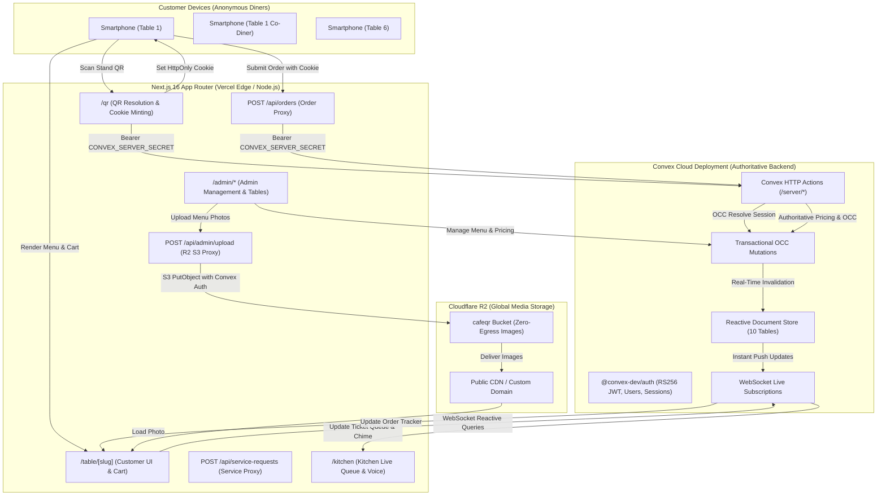

# Courista — Final System Architecture
**Cafe:** Ember & Oak  
**Version:** Milestone 4 Final (Production Ready)  
**Stack:** Next.js 16 (App Router) + React 19 + TypeScript + Convex + Convex Auth + Cloudflare R2

---

## 1. Architectural Overview

Courista is a bespoke, real-time digital QR dining and table-ordering platform built specifically for **Ember & Oak**, a luxury single-cafe establishment operating with six physical tables.

The system replaces traditional monolithic databases, REST polling, and third-party table management systems with an event-driven, reactive cloud architecture using **Convex** as the single authoritative backend.



---

## 2. Customer QR & Session Lifecycle Architecture

### 2.1 The Two-Tier Hardened Session Model
Diners do not create accounts or download apps. Instead, security is enforced through a cryptographically isolated two-tier token model:

1. **Physical Stand QR Token (`qrToken`):**
   - Each of the 6 tables has a physical acrylic stand encoding `/qr?table=table-N&token=<RAW_32_BYTE_HEX>`.
   - The raw token is **never stored** in the database. Only its SHA-256 hash (`qrTokenHash`) is stored in `tables`.
   - When scanned, Next.js `/qr` exchanges the token with Convex via the trusted HTTP gateway, strips the token from the browser URL bar, and issues a 307 redirect to `/table/table-N`.

2. **Customer Write Session Token (`customerToken`):**
   - A 32-byte cryptographic random hex token stored exclusively in an **HttpOnly, Secure, SameSite=Lax** browser cookie (`cafe_customer_session`).
   - JavaScript executing in the diner's browser cannot access this cookie, preventing XSS-based order forgery.
   - Convex stores only `customerTokenHash` (SHA-256).

3. **Customer Read Capability Token (`readCapabilityToken`):**
   - A separate 32-byte hex token stored in a standard client cookie (`cafe_customer_read_token`).
   - Passed as an argument to Convex read queries (`api.orders.getCustomerTableOrders`, `api.billing.getCustomerTableBill`, `api.service_requests.getCustomerServiceRequests`).
   - Read tokens cannot perform write actions or mutate table states.

### 2.2 Table Dining Session Coalescing (OCC Protection)
When multiple diners sit at Table 1 and scan the stand QR at the same moment:
- All concurrent scans are idempotently coalesced into the **single active `tableOrderSessions` record** for that table.
- Each device receives its own unique `customerScanSessions` record attached to the shared table session.
- Both diners see cumulative table tickets in real time, with the UI indicating `isCurrentDevice: true` for orders they personally placed.
- Sessions automatically expire after a 12-hour sliding window.

---

## 3. Server-Mediated Customer Write Security Boundary

To protect the cafe against order spoofing, total manipulation, and inventory exhaustion, customer write operations do NOT hit Convex public mutations directly.

```
Diner Browser (Cart) 
    ──> Next.js Server Route (/api/orders) [Reads HttpOnly Cookie]
            ──> Convex HTTP Action (/server/orders/submit) [Auth: Bearer CONVEX_SERVER_SECRET]
                    ──> Convex Transactional Mutation [Authoritative Pricing & Line Snapshot]
```

### Protection Guarantees:
1. **Zero Client Price Trust:** Client-supplied prices and totals are discarded. Prices are looked up directly from `menuItems.pricePaise` in the database. If a malicious client tries to manipulate prices, the request is rejected (`PRICE_MANIPULATION_DETECTED`).
2. **Integer-Paise Accounting:** All money values are strictly integer paise (e.g. ₹350.00 = `35000` paise). No floating-point rounding drift can ever occur.
3. **Idempotency Prevention:** Each order submission includes a unique `idempotencyKey`. Duplicate submissions (e.g. from network retries or rapid clicking) return the existing ticket with zero duplicate charges.
4. **86 Inventory Protection:** Ordering an item marked `isAvailable: false` is rejected server-side (`ITEM_UNAVAILABLE`).
5. **Session Revocation Gate:** Ordering against an expired or closed session is strictly rejected (`SESSION_CLOSED`).

---

## 4. Kitchen Real-Time Workflow & Order Lifecycle

The kitchen operates a high-tempo, zero-latency dashboard at `/kitchen` connected to Convex via live WebSockets.

### 4.1 State Machine
```
NEW / PENDING ──> PREPARING ──> DELIVERED (Terminal)
      │               │
      └──> CANCELLED <┘ (Requires Staff Reason)
```
- **Strict Linear Transitions:** Skipping the preparation step (`NEW -> DELIVERED`) or backwards transitions (`DELIVERED -> PREPARING`) are rejected server-side (`INVALID_STATUS_TRANSITION`).
- **Grouping by Table:** Orders from Table 1 placed minutes apart remain distinct order tickets while being grouped visually under Table 1 for kitchen ergonomics.
- **Audio Voice Synthesis:** When an order or service request arrives, HTML5 Audio plays pre-rendered MP3 voice announcements ("New order Table 1", "Request water Table 3") using female voice assets cached in `/public/audio/kitchen/`.

---

## 5. Admin & Management Workflow

The admin dashboard (`/admin/*`) provides full operational control over the establishment:
1. **Role-Based Access Control (RBAC):**
   - `@convex-dev/auth` issues signed RS256 JWTs.
   - User accounts carry `role: "admin"` or `role: "kitchen_staff"`.
   - Non-admin staff attempting to access `/admin` are rejected at both client layout and server backend levels (`FORBIDDEN`).
2. **Catalog Administration:**
   - Real-time creation, editing, and display reordering of categories and menu items.
   - Referential integrity enforcement: deleting a category with assigned menu items is blocked (`CATEGORY_IN_USE`).
   - One-click 86'ing: Toggling availability instantly excludes the item from diner menus and blocks ordering in real time.
3. **Table & QR Management:**
   - Listing of all 6 physical tables.
   - Table disabling (`toggleTableActive`).
   - Cryptographic QR regeneration: Generates 32 bytes of secure entropy, computes SHA-256 hash in browser, commits hash to Convex, and prints high-resolution vector QR stand cards. Previous QR codes are instantly invalidated.

---

## 6. Billing, Settlement & Atomic Table Closure

The table billing system guarantees financial consistency and floor coordination:
1. **Authoritative Running Bill:**
   - Computed server-side from immutable `orderItems` snapshots.
   - Segregates delivered orders (`payableAmountPaise`), preparing orders (`pendingAmountPaise`), and cancelled orders (excluded from total).
2. **Unfinished Order Guard:**
   - A table session CANNOT be settled or closed if any orders remain `NEW` or `PREPARING` (`UNFINISHED_ORDERS_EXIST`). Line cooks must deliver or cancel pending tickets first.
3. **Atomic Settlement Mutation (`settleAndCloseTableSession`):**
   When staff confirms payment (`CASH`, `CARD`, `UPI`, `OTHER`):
   - Validates that no unfinished tickets remain.
   - Atomically transitions all delivered tickets to `PAID`.
   - Resolves all open service requests for that table.
   - Transitions `tableOrderSessions.status` to `CLOSED`.
   - Atomically revokes all diner scan sessions (`customerScanSessions.isActive = false`).
4. **Duplicate Settlement Guard:** Attempting to re-settle a closed session is rejected (`SESSION_ALREADY_CLOSED`).
5. **Subsequent Diners:** When a new dining party sits at Table 1 and scans the stand QR, a brand new `tableOrderSessions` record is initialized with clean zero balance.

---

## 7. Cloudflare R2 Media Storage Architecture

- **High-Performance Direct S3 Client:** Node.js AWS S3 SDK (`@aws-sdk/client-s3`) configured with Cloudflare R2 endpoint.
- **Convex Bearer Token Verification:** The upload API route (`/api/admin/upload`) verifies that the caller has a valid Convex session with `role === "admin"` before streaming images to R2.
- **Zero Egress Fees:** Assets are served directly from Cloudflare R2's global edge network via custom domain or R2.dev subdomain.
- **Fail-Safe Fallbacks:** If an image is missing or cannot load, the customer UI falls back gracefully to luxury vector SVG silhouettes.

